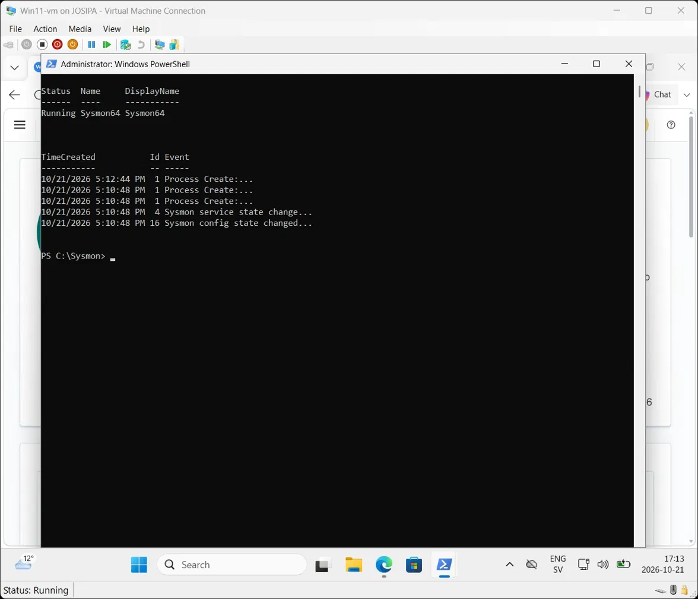
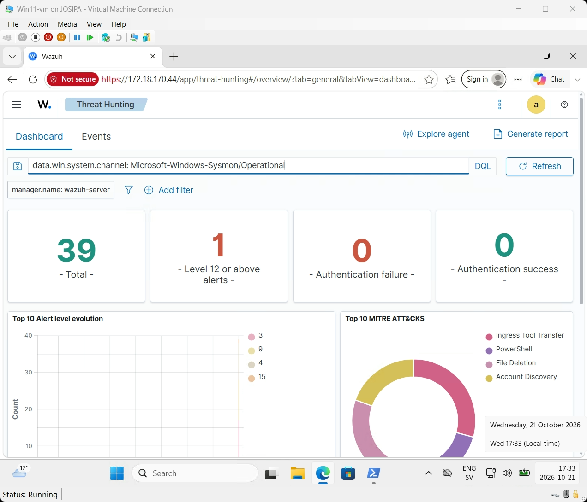
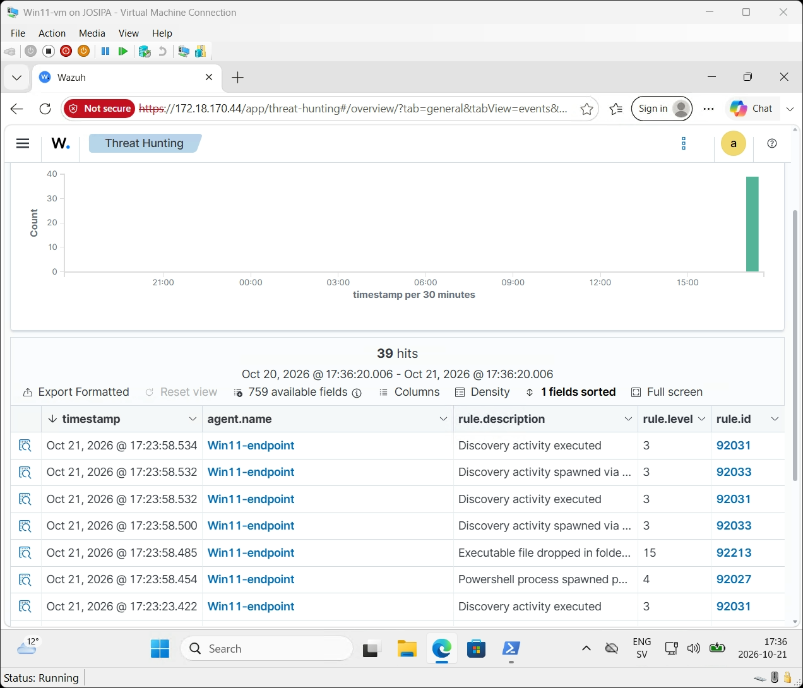
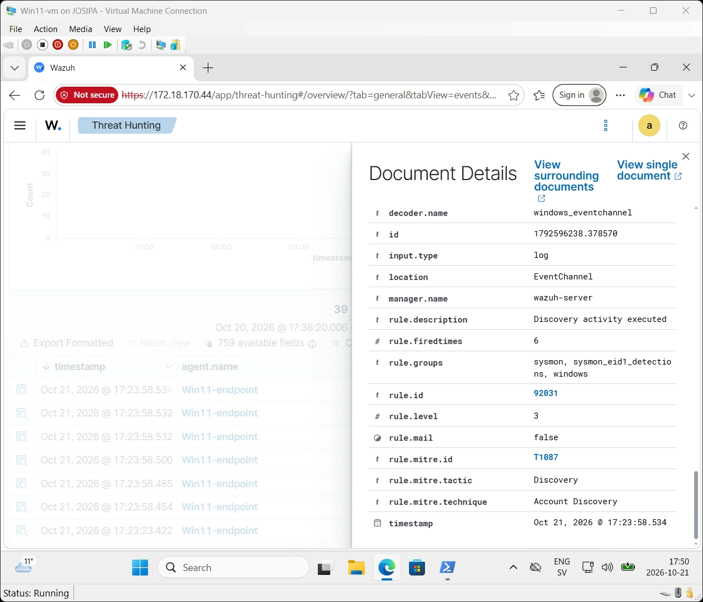

# 06 — Process Monitoring with Sysmon (v2)

## Why Sysmon?

By default, Windows logs things like logons (4624/4625), but it does **not** record in
detail which programs start, who started them, with which command line, or what they
connect to. That is exactly the information an analyst needs to spot an attacker who is
already on a machine.

**Sysmon** (System Monitor, part of Microsoft Sysinternals) fills that gap. It writes
detailed events to its own Windows log channel, and the Wazuh agent forwards them to
the server, where Wazuh's built-in Sysmon rules map them to MITRE ATT&CK techniques.

```
Windows 11  →  Sysmon  →  Microsoft-Windows-Sysmon/Operational  →  Wazuh agent  →  Wazuh server  →  alert
```

## 1. Install Sysmon with a community configuration

Run in an **Administrator** PowerShell on the Windows endpoint:

```powershell
New-Item C:\Sysmon -ItemType Directory -Force | Out-Null; cd C:\Sysmon
Invoke-WebRequest https://download.sysinternals.com/files/Sysmon.zip -OutFile Sysmon.zip
Expand-Archive Sysmon.zip -Force
Invoke-WebRequest https://raw.githubusercontent.com/SwiftOnSecurity/sysmon-config/master/sysmonconfig-export.xml -OutFile sysmonconfig.xml
.\Sysmon\Sysmon64.exe -accepteula -i sysmonconfig.xml
```

I used the **SwiftOnSecurity** configuration, a widely used public baseline. It decides
what Sysmon records and filters out a lot of normal background noise, so the log stays
useful instead of overwhelming.

Verification:

```powershell
Get-Service Sysmon64
Get-WinEvent -LogName "Microsoft-Windows-Sysmon/Operational" -MaxEvents 8
```



| Sysmon Event ID | Meaning |
|---|---|
| 1 | Process Create — a new process started (the most important one for detection) |
| 4 | Sysmon service state changed (started) |
| 16 | Sysmon configuration loaded |

## 2. Tell the Wazuh agent to read the Sysmon channel

The agent only reads the log channels listed in its configuration. I added the Sysmon
channel to `C:\Program Files (x86)\ossec-agent\ossec.conf`:

```xml
<ossec_config>
  <localfile>
    <location>Microsoft-Windows-Sysmon/Operational</location>
    <log_format>eventchannel</log_format>
  </localfile>
</ossec_config>
```

Then restarted the agent (`Restart-Service WazuhSvc`). The agent log confirmed:
`Analyzing event log: 'Microsoft-Windows-Sysmon/Operational'`.

## 3. Test: simulate attacker "discovery" activity

Wazuh does not raise an alert for every process start (that would be thousands per
hour). Its built-in Sysmon rules alert on **suspicious patterns**. To test, I ran the
kind of harmless, read-only commands an attacker typically runs right after getting in
— "who am I, which users exist, who is an administrator?":

```powershell
powershell -Command "whoami /all; net user; net localgroup administrators; ipconfig /all"
```

## 4. Results

Filtering Threat Hunting on `data.win.system.channel: Microsoft-Windows-Sysmon/Operational`
showed **39 Sysmon-based alerts**, mapped to MITRE ATT&CK techniques including
**Account Discovery**, **PowerShell**, **Ingress Tool Transfer** and **File Deletion**.





| Rule ID | Description | Level | What triggered it |
|---|---|---|---|
| 92031 | Discovery activity executed | 3 | `whoami`, `net user`, `net localgroup administrators` |
| 92033 | Discovery activity spawned via PowerShell | 3 | The same commands, launched from PowerShell |
| 92027 | PowerShell process spawned PowerShell | 4 | `powershell -Command ...` started from PowerShell |
| 92213 | Executable file dropped in folder commonly used by malware | 15 | See "false positive" below |

**Ingress Tool Transfer** was triggered by my own `Invoke-WebRequest` downloads of
Sysmon — downloading a tool from the internet is exactly what an attacker does after
gaining access, so Wazuh is right to flag it.

### One alert in detail




- **Command line:** `C:\WINDOWS\system32\net1 localgroup administrators`
- **Description / company:** Net Command, Microsoft Corporation
- **Hashes:** MD5 / SHA256 of the executable (lets an analyst verify it is the genuine
  Microsoft binary and not a look-alike)
- **MITRE ATT&CK:** T1087 — Account Discovery (tactic: Discovery)
- **Rule groups:** `sysmon, sysmon_eid1_detections` — fired from Sysmon Event ID 1

A detail worth noticing: I typed `net localgroup ...`, but Sysmon recorded `net1.exe`.
`net.exe` hands the work to `net1.exe` in the background. Standard Windows logs would
not show this; Sysmon does.

### A false positive — and how an analyst handles it

Rule **92213** fired at **level 15** (the highest severity in this lab) at the same
moment as my test command. My assessment is that it is most likely **benign**: when
PowerShell starts, it writes a small temporary test script to the user's `%TEMP%`
folder, and a script file appearing in a temp folder looks like "malware dropping a
file" to the rule.

To confirm, an analyst would open the alert and check `TargetFilename` and the process
that created it. If it is PowerShell's own temporary test file, the right action is to
document it and, in a real environment, tune the rule with an exception for that exact
pattern — not to disable the rule.

Recognising and handling false positives is a daily part of SOC work: a high severity
level does not automatically mean a real attack.
