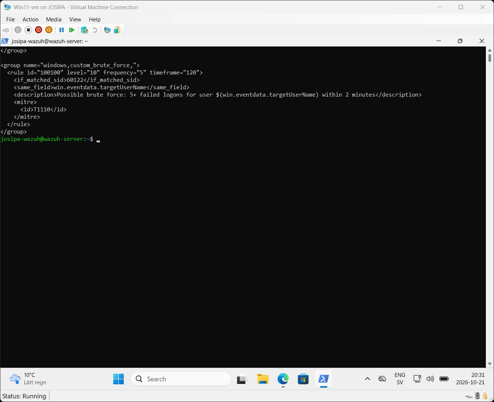
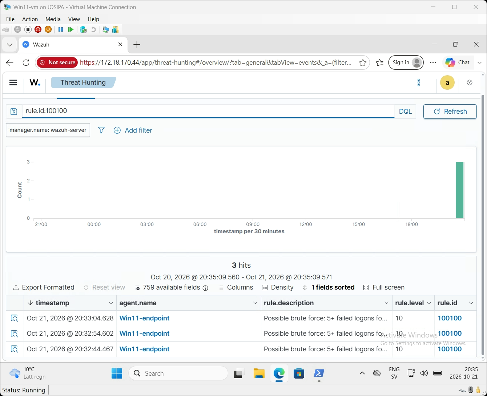
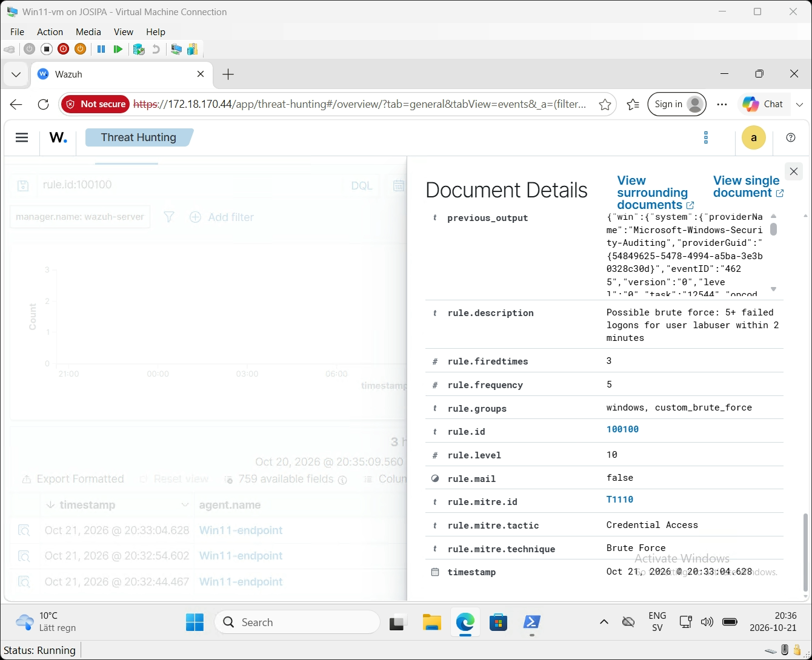

# 07 — Custom Detection Rule: Brute Force (v2)

## The problem

Wazuh's built-in rule **60122** ("Logon Failure – Unknown user or bad password") fires
on **every** failed Windows logon (Event ID 4625), at level 5. But a single failed logon
is usually just a typo. What matters is the **pattern**: many failures against the same
account in a short time — a classic brute-force or password-guessing attempt.

So instead of only *using* the built-in rules, I wrote my own **correlation rule** —
moving from operating the SIEM to tuning it (detection engineering).

## The rule

File on the server: `/var/ossec/etc/rules/local_rules.xml`
(also in this repo: [`rules/local_rules.xml`](../rules/local_rules.xml))

```xml
<group name="windows,custom_brute_force,">
  <rule id="100100" level="10" frequency="5" timeframe="120">
    <if_matched_sid>60122</if_matched_sid>
    <same_field>win.eventdata.targetUserName</same_field>
    <description>Possible brute force: 5+ failed logons for user $(win.eventdata.targetUserName) within 2 minutes</description>
    <mitre>
      <id>T1110</id>
    </mitre>
  </rule>
</group>
```



| Part | Meaning |
|---|---|
| `id="100100"` | Custom rules use IDs from 100000 upwards so they never clash with Wazuh's own rules |
| `level="10"` | High severity (the single failed logon it builds on is only level 5) |
| `frequency="5" timeframe="120"` | Fire when the condition is met 5 times within 120 seconds |
| `if_matched_sid 60122` | Only count events that already matched "failed logon" |
| `same_field targetUserName` | All 5 failures must be for the **same account** — 5 different users with one typo each is not the same thing as an attack on one account |
| `$(win.eventdata.targetUserName)` | Puts the attacked username directly into the alert text |
| `T1110` | MITRE ATT&CK: Brute Force (tactic: Credential Access) |

## Loading the rule safely

```bash
sudo /var/ossec/bin/wazuh-analysisd -t && sudo systemctl restart wazuh-manager
```

`wazuh-analysisd -t` tests all rules **before** the restart. If the new rule had a
syntax error, the test would fail and the manager would not be restarted — so a typo in
a rule cannot take the SIEM down.

## Test: simulate a brute-force attack

On the Windows endpoint I repeatedly tried to start a process as a user `labuser` with
a wrong password — the same thing an attacker guessing passwords produces in the logs:

```powershell
$p = ConvertTo-SecureString 'WrongPass!' -AsPlainText -Force
1..8 | ForEach-Object {
    $c = New-Object PSCredential('labuser', $p)
    try { Start-Process cmd.exe -Credential $c -ErrorAction Stop } catch {}
    Start-Sleep 2
}
```

Windows recorded **16 failed logons (Event ID 4625)** within two minutes (the loop ran
twice).

## Result





- **3 alerts**, rule **100100**, level **10**, agent `Win11-endpoint`
- Description: *"Possible brute force: 5+ failed logons for user labuser within 2 minutes"*
- **MITRE:** T1110 — Brute Force, tactic Credential Access
- `rule.firedtimes: 3` — 16 failures, grouped in batches of 5, produced 3 alerts,
  exactly as designed
- `previous_output` — Wazuh stores the original 4625 events that triggered the alert,
  so an analyst sees the evidence immediately

## What an analyst would do next

1. Check whether `labuser` is a real account and who owns it.
2. Look at the source of the attempts (local or network logon, source IP).
3. If it is not a known user mistake: lock or reset the account, block the source, and
   check for a **successful** logon (4624) right after the failures — that would mean the
   password was guessed.

## Possible improvements

- A second rule for **password spraying**: many *different* accounts failing from the
  **same source** (`same_field` on the source IP instead of the username).
- A follow-up rule: failed logons followed by a successful logon for the same account.
