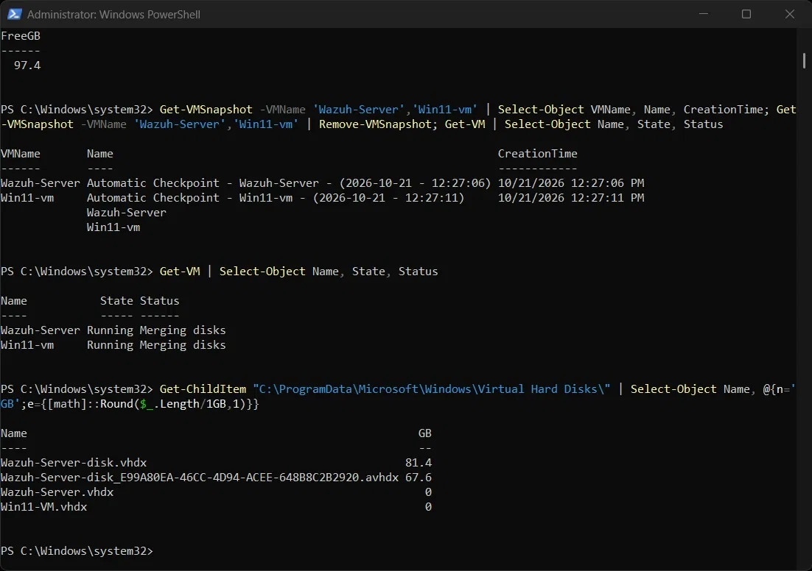
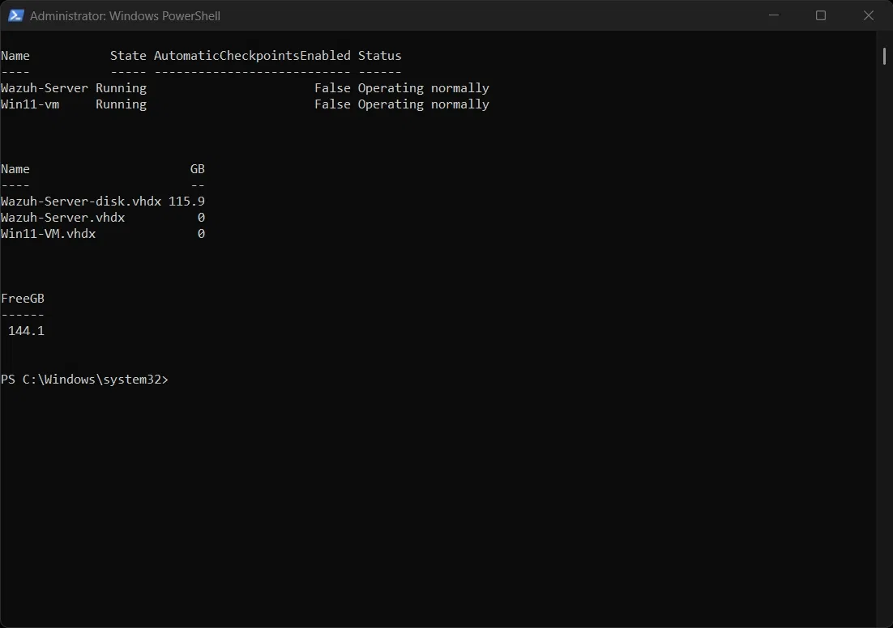
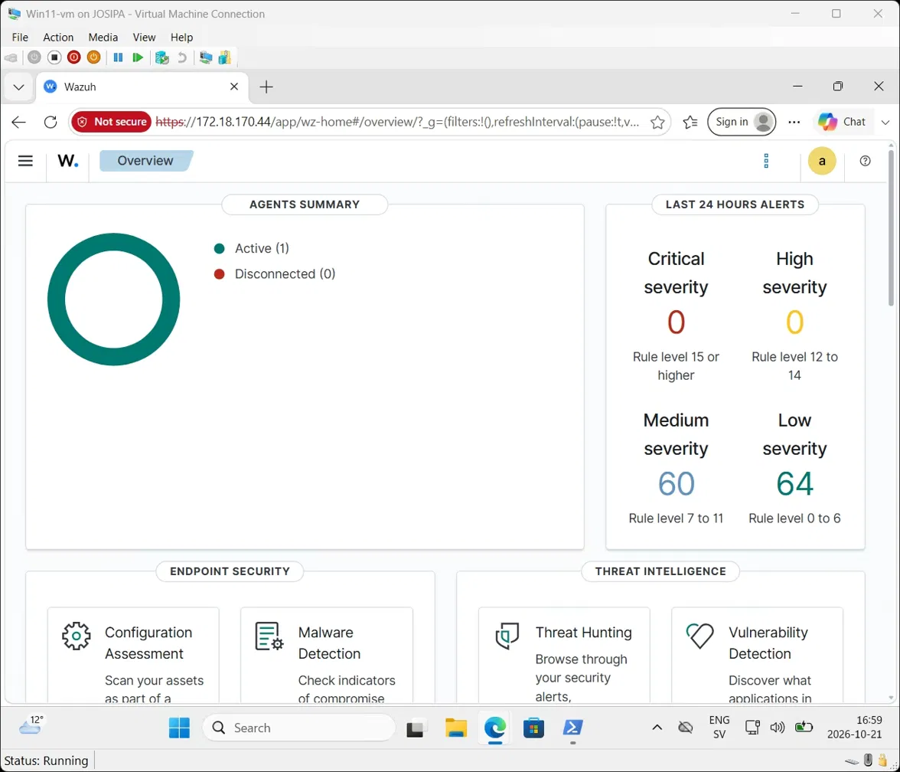

# 08 — Troubleshooting During v2

Before any new work could start, the lab had to be brought back to a working state.
These were real problems, and diagnosing them taught me as much as the planned work.

## Problem 1 — The two VMs were on different subnets

**Symptom:** the Windows endpoint could not reach the Wazuh server.

**Cause:** Hyper-V's *Default Switch* can hand out a new subnet after the host restarts.
The server got a new address via DHCP, while Windows still had an old static address
from the previous subnet.

**Fix:** switched the Windows endpoint from a static address to DHCP, so both machines
receive addresses from the same Default Switch subnet. Then pointed the Wazuh agent at
the server's new address (`<address>` in `ossec.conf`) and restarted the agent.

## Problem 2 — VMs paused with "Disk(s) encountered critical IO errors"


**Symptom:** both VMs suddenly paused (`PausedCritical`).

**Diagnosis:** the host's C: drive had **0 GB** free. Searching for large files showed
that the VM disks were far bigger than expected — and that both VMs had
**automatic checkpoints** (`.avhdx` files), created by Hyper-V that same day when the
VMs were started.



**Root cause:** Hyper-V on Windows 11 creates a checkpoint automatically every time a
VM starts. While a checkpoint exists, all disk writes go into a separate differencing
file. Wazuh writes constantly (logs, index data), and each small write allocates a whole
block in that file — so the Wazuh server's checkpoint grew to **67 GB in about 1.5 hours**
and filled the host disk.

**Fix:**
1. Removed duplicate ISO files and old, no-longer-needed lab VMs and their disks.
2. Deleted the checkpoints, which merges them back into the main disks
   (`Get-VMSnapshot ... | Remove-VMSnapshot`), done while the VMs kept running.
3. Disabled automatic checkpoints so it cannot happen again:
   ```powershell
   Set-VM -Name 'Wazuh-Server','Win11-vm' -AutomaticCheckpointsEnabled $false
   ```

Result: from **0 GB to 144 GB free**, both VMs running normally.



**Lesson:** checkpoints are useful before risky changes, but they are not backups and
should not be left running on a VM that writes a lot of data.

## Problem 3 — Agent "Disconnected" even with the correct server address

**Symptom:** the agent kept showing *Disconnected*. Its log said
`Unable to connect to [server]:1514/tcp: ... actively refused it`.

**Diagnosis:** the server was reachable (ping and the dashboard worked), but nothing was
listening on port **1514** — the port where the manager receives agent data. The
manager's receiving component had stopped, most likely when the host disk filled up.

**Fix:** restarted the manager and confirmed it was listening again:

```bash
sudo systemctl restart wazuh-manager
sudo ss -tlnp | grep 1514     # → wazuh-remoted listening on 0.0.0.0:1514
```

The agent reconnected on its own within seconds.



**Lesson:** "can't connect" has layers — network, port, service. Checking them in order
(ping → port test → service status → logs) finds the problem quickly instead of guessing.
